# v1.9.1: native Windows update based on released v1.8.2

Fixes V8 installation being blocked by the pinned historical `07ffd8df…` menu-library extent variant. Both this exact variant and the canonical library are accepted for V8; the R15NH module/resources, four CFG records and two live LUTs still must pass validation. Status identifies the menu variant. Replace the EXE while retaining original sessions and rollback backups; this mismatch does not require reinstalling R15NH. [Download v1.9.1](https://github.com/zhangjb029/ILCE-9_Slog_Project/releases/tag/v1.9.1).

R15NH uses the original read, identify, local R12P patch, and FF01 write workflow. No complete partition image is bundled. V8 has a separate deployment tab and requires R15NH. Both support original-session rollback. See [current instructions](README.md) and the in-app operating guide. The older documentation below is retained for the original features.

Media authoring guides (Chinese): [LUT fitting and A9P](docs/authoring/R15_V8_LUT拟合与A9P制作详解.md), [shutter audio and A9W](docs/authoring/R15_V8_快门声A9W制作详解.md). Portable offline source, a frozen synthetic fitting baseline, a licensed CUBE example, and format checks are in [tools/media](tools/media/README.md). This documentation/source update creates no new software version or Release.

---

# ILCE-9_Slog_Project

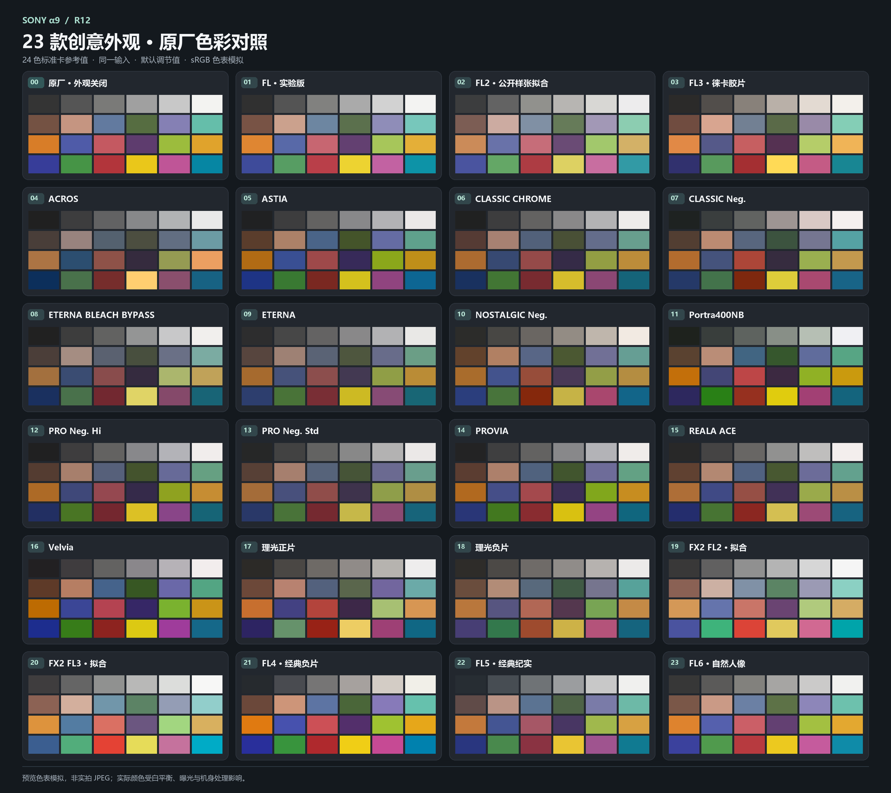

Put Picture Profile and S-Log Display Assist into the Fn menu of a Sony A9 (ILCE-9, firmware 6.00) — plus 75 other functions the camera ships with but never exposes.

[简体中文](README.md)

**The window now has an "electronic-shutter flash" tab**: read the current state, open the upper-layer rule and the AV eligibility gate as two separate steps, and restore from either journal. The same operations remain available as `python -m a9tool.flash` and `python -m a9tool.flash_av` (read-only by default). As of 2026-11-11 the user confirmed that with both settings open, single-frame electronic shutter actually fires a flash; electronic burst still fires only the first frame, and hardware safety is not verified. Procedure, restore and limits: [delivery notes](docs/FLASH_DELIVERY.zh-CN.md) (Chinese).

**The "Unlock 5 GHz Wi-Fi" tab** makes the camera able to join a 5 GHz router: it changes one byte of the backup (`00A5000C`, `09` → `03`) so the camera uses the 5 GHz regulatory configuration it already ships with. No firmware, no power change. Confirmed on hardware on 2026-11-16: 5 GHz association, FTP transfer, and reconnect after a power cycle.

**The "Creative Look LUT" tab** puts 23 Creative Looks on page 14 of Shooting Assist, moving Picture Profile and Gamma Display Assist there too and letting 照片效果 and 演示模式 return to their own slots. FL4–FL6 add grain, halo and vignette. That one replaces a whole partition. It still ships no image and downloads none — the patch lives in the program and applies to a partition you read from your own camera and hash-check. See [the full steps](#creative-look-lut---replaces-a-300-mib-partition).

**The "Force rollback" tab** puts the whole camera back to factory using Sony's own 6.00 package: it first changes the version the body reports to 5.00 (two bytes in `/setting/updater/dat4`, nothing in the firmware itself), which makes the updater willing to install 6.00 again. The update rewrites `/usr` and the other firmware partitions, so the Creative Look LUT and every other partition change is gone; when it finishes, the updater writes 6.00 back on its own. See [the full steps](#force-rollback---the-official-package-rewrites-the-firmware).

---

## Change log

### v1.8.2 (2026-11-17)

**Fixed**

- **libusb's "operation not supported" now says what it is**: pyusb maps `LIBUSB_ERROR_NOT_SUPPORTED` (-12) to `NotImplementedError`, and PMCA's driver only converts `usb.core.USBError` — so it reached the UI looking like a programming mistake. The message now names -12, gives the two usual causes on Windows (interface not bound to a libusb-compatible driver; device dropped or reset mid-transfer) and the Zadig / replug steps.
- **The technical block adds this package's own stack frames**: it used to show only the innermost frame, which is almost always inside vendored `libusb1.py` and points at pyusb rather than at what the tool was doing.

### v1.8.1 (2026-11-17)

**Fixed**

- **An unexpected failure now says what actually failed**: every message ends with a technical block naming the exception, the USB transfer phase and frame it died in, how many partition bytes had arrived, and the code location. A remote report previously showed only the generic sentence.
- **The timeout message was wrong**: a partition read allows 900 seconds, but the error always said "30 seconds". It now reports the real budget, and a timeout has its own hint.
- **The session directory is printed at startup** and again before every backup, write and restore. "sessions is empty" usually means the exe was run from a different folder than the one being inspected.

### v1.8.0 (2026-11-17)

**New**

- **A "force rollback" tab**: changes the version the body reports from 6.00 to 5.00 so Sony's official 6.00 package will install again. That update rewrites `/usr` and the other firmware partitions, so the Creative Look LUT and every other partition change disappears; the updater writes 6.00 back when it finishes.
- It writes only the two bytes in `/setting/updater/dat4` — no firmware content. The old value reaches disk first, the write is read back byte for byte, one session allows exactly one write, and both the path and the length are pinned in an allowlist.
- The tab also connects while the body reports 5.00 (every other tab still requires 6.00), so a version that was opened but not updated can be put back.

### v1.7.0 (2026-11-17)

**New**

- **The Creative Look LUT target is now R12**: 23 looks, FL4–FL6 adding grain, halo and vignette. Menu layout unchanged.
- **The backup names its build** (new step ②): compares the look module, the menu library and both language resources, and reports whether the camera is on 原厂 6.00 / R8 / R9.1 / R10 / R11 / R12. A whole-partition hash cannot do this — the camera rewrites ext2 mount counters and timestamps at every boot.
- **The tab is six steps**: backup → identify → patch → write → 4:3 parameters → roll back.
- **The first backup can be retaken**, with a warning that the new one captures the current state rather than the factory one.
- Version number in the title bar and on the first tab.

**Fixed**

- **The 300 MiB partition channel**: `oData` was dropped by an intermediate layer, replies were capped at 2 MiB and three frames, and requests were never split and capped at 1 MiB. The tab could not complete its first read. Replies now stream straight to the file, requests leave as 1 MiB packets, and the frame loop runs until the declared total is exhausted. Verified on hardware: the dump matched the release image block for block.
- **Hashing slowed the UI**: every refresh recomputed SHA256 over 300 MiB, which became noticeable once a backup existed. Cached against file size and mtime.

### v1.6.1 (2026-11-17)

**Fixed**

- **Reverted a regression from v1.5.1**: it decided from the product ID whether reply blocks carry a 512-byte separator. Right for one class of 0x0336 body, disastrous for the other — **every** Fn-slot and flash read/write failed, and a 300 MiB read stopped at the first 32 KB block. Always draining is back (the v1.5.0 behaviour, which the tested hardware needs); bodies that need the other framing set `A9TOOL_UNPADDED=1`.

### v1.6.0 (2026-11-17)

**New**

- **"Unlock 5 GHz Wi-Fi" tab**: changes one byte of the backup, `00A5000C` (09 → 03), so the camera uses the XR77 radio-regulatory configuration it already carries — the default XR83 has an empty 5 GHz channel list. No firmware, no driver, no change to transmit power.
- Confirmed on hardware: 5 GHz association, channel 161 confirmed on the router with an assigned IP, FTP transfer, reconnect after a full power cycle, and a clean 2.4 GHz regression.

**Fixed**

- A mid-read `Pipe error` no longer says "try another cable" — it says the camera may have dropped off USB and that repeating the attempt will not help.
- The connect log prints the service-mode product ID.

## What it does

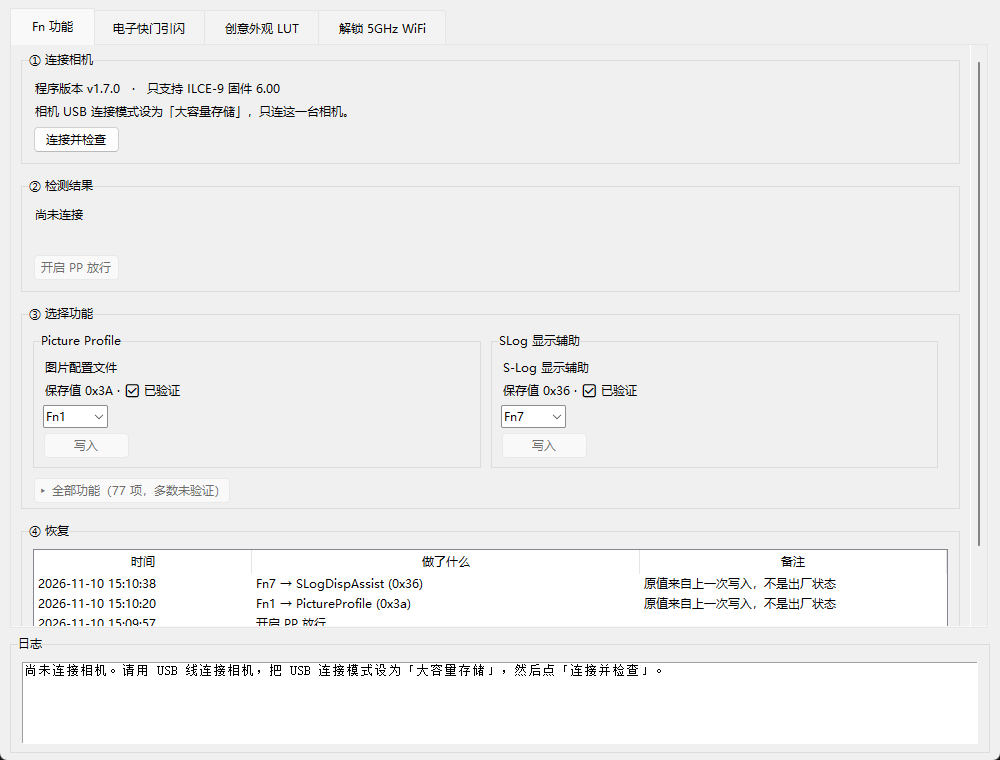

The A9 has Picture Profile and S-Log Display Assist compiled in, but no menu entry to reach them. This tool writes a one-byte saved value into one of the twelve Fn slots through Sony's own service-mode parameter interface. The camera resolves that byte through its own function table, so the entry appears in the Fn menu. **No firmware is modified.**

Two functions have been confirmed on real hardware:

| Function | Saved value | Result on camera |
|---|---|---|
| Picture Profile | `0x3A` | Fn slot shows the entry, the recorded image changes, survives a restart |
| S-Log Display Assist | `0x36` | Fn slot shows the entry, works, survives a restart |

The other 75 values come from the camera's own function table and are selectable in the app. **None of them has been tested on hardware.** One — Pixel Shift Multi Shooting (`0x64`) — is known to hang the camera after the first frame and require a battery pull; the app marks it red and asks twice.

## Requirements

- Sony **ILCE-9** with firmware **6.00**. Nothing else. The app reads the model and version first and refuses everything else before writing.
- Windows 10 or 11.
- [Zadig](https://zadig.akeo.ie/) — free, no install needed. You will use it twice.
- One battery, charged. A USB data cable (not a charge-only cable).

> **The app's interface is in Chinese.** Every step below gives the Chinese button label with its meaning, so you can follow it without reading Chinese.

---

## Step-by-step

This is the whole procedure. If you are an AI agent following it, stop and ask your human before any step marked **⚠ writes to the camera**.

### Step 0 — Check the camera

On the camera: **MENU → Setup → Version**. It must say **6.00**, and the body must be an **ILCE-9** (not ILCE-9M2).

If not: stop. Different firmware keeps parameters at different addresses, and the app will refuse anyway.

### Step 1 — Get the executable

Download `ILCE-9_Slog_Project.exe` from this repository's **Releases** page. Put it somewhere persistent, e.g. `C:\A9Tool\`.

There is no installer and no uninstaller. On first run it creates a `sessions` folder next to the exe — that folder holds the backups, **do not delete it**.

### Step 2 — Get past SmartScreen

Double-click. Windows will say *"Windows protected your PC"*. Click **More info → Run anyway**.

The exe is unsigned (a code-signing certificate costs several hundred dollars a year). Antivirus software may also flag it, because it talks to a USB device directly. The source is in this repository — read it if you want.

### Step 3 — Install the driver for Mass Storage

1. Camera **off** → connect the USB cable → camera **on**.
2. If the camera asks how to connect, choose **Mass Storage**. The memory card should appear in Windows Explorer.
3. Open **Zadig**.
4. **Options → List All Devices**.
5. In the dropdown, select your camera — it may appear as `Sony Digital Still Camera` or similar.
6. Confirm the target driver on the right says **libusb-win32**; use the arrows to change it if it does not.
7. Click **Install Driver** (or **Replace Driver**) and wait for it to finish.

> **Do not pick `USB Input Device` / VID `054C` PID `0994`.** That is the camera's USB *input* interface, not the storage device this tool talks to. Replacing its driver breaks that input device on your PC.

**Expect:** after this, Windows Explorer no longer shows the memory card, and you may get a "you need to format this disk" popup. **That is normal. Do not format.** Section "Restoring the camera to Windows" at the end puts it back.

### Step 4 — Connect

1. Run `ILCE-9_Slog_Project.exe`. A single window opens with four numbered sections and a log at the bottom.
2. Click **连接并检查** (*Connect and check*) in section ① .

**Expect, in the log:**

```
已确认 ILCE-9 / 6.00，正在切换服务模式     ← model confirmed, switching to service mode
服务模式已认证，正在读取机身参数            ← service mode authenticated, reading parameters
```

and section ② fills in with model, firmware, and a serial fingerprint.

**If the log says `Service device not found`:** go to step 5.

**If the log says 没有找到相机 (*no camera found*):** the camera is not in Mass Storage mode, or the driver from step 3 is not installed, or the cable is charge-only.

### Step 5 — Install the driver again (only if step 4 failed)

Service mode is a **different USB device** and needs its own driver install. This is normal and expected.

1. Leave the camera plugged in, exactly as it is.
2. Open **Zadig** again → **Options → List All Devices**.
3. A new Sony device is now listed, usually with `(Interface 1)` in the name.
4. Install **libusb-win32** for it too.
5. Back in the app, click **重试** (*Retry*).

**Expect:** the connection completes and section ② fills in.

> The retry token expires after one hour. If it does, unplug the camera, return it to Mass Storage, and start again from step 4. Nothing has been written at this point, so restarting is safe.

### Step 6 — Enable the PP override  ⚠ writes to the camera

Section ② shows **PP 放行** (*PP override*) as **✗ 未开启** (*off*).

Click **开启 PP 放行** (*Enable PP override*), confirm, and wait for **SAVED_AND_READBACK_VERIFIED** or a success message in the log.

This writes **five bytes** in one 1024-byte property. It does **not** touch any Fn slot.

**Then power the camera off and on.** The camera only re-reads these parameters at boot. Do not skip this.

**If section ② shows ⚠ 状态异常 (*inconsistent state*):** the five bytes are partly set. The app refuses to write. Use **恢复全部原厂** (*Restore factory*) in section ④, or start over.

### Step 7 — Write a function into a slot  ⚠ writes to the camera

Run the app again and repeat step 4 (no driver install needed this time).

Section ③ now shows two cards: **Picture Profile** and **SLog 显示辅助**. Each has a slot dropdown (**Fn1** … **Fn12**) and a write button.

1. Pick a slot.
2. Click the write button (写入).
3. Confirm.

For anything else, expand **▸ 全部功能（77 项，多数未验证）** (*all functions, 77 items, mostly untested*), select a row, choose a slot, click **写入所选功能**.

**Expect:** `SAVED_AND_READBACK_VERIFIED` in the log, and **every write button greys out**. That is deliberate — one run of the program performs exactly one change, each with its own backup. To change another slot, close and reopen the app.

**Then power the camera off and on.**

### Step 8 — Confirm on the camera

Press **Fn**. The slot you wrote to should now show the function.

> **"It appears in the menu" is not "it works."** All twelve slots accept a write and the camera displays the entry — but an entry existing only means the entry exists. Picture Profile and S-Log Display Assist are confirmed working. The other 75 have never been tried on hardware; expect greying out, no effect, or a freeze.

### Step 9 — Undo

**One change:** section ④ lists every write with a timestamp. Select a row → **从备份恢复到原状** (*restore from this backup*) → power-cycle.

Each row's "original" value is the value *before that particular write*. If you made several changes, undoing the second returns you to the state after the first, not to factory. The list marks those rows.

**Everything:** **恢复全部原厂** (*restore all*) writes back every position this tool has touched, as it was before first use. It will also overwrite settings you changed by hand on the camera.

### Restoring the camera to Windows

When you are done with this tool, or when the official updater and Explorer need to see the camera again:

1. Close the app.
2. Right-click Start → **Device Manager**.
3. Expand **libusb-win32 devices** and right-click the `ILCE-9` entry under it.
4. **Update driver** → **Browse my computer for drivers** → **Let me pick from a list of available drivers on my computer**.
5. Tick **Show compatible hardware**, select **USB Mass Storage Device**, click **Next** and wait for it to finish.
6. The memory card reappears in Explorer when the switch is done.

Change only the camera entry. Leave every other USB device alone.

---

## Electronic-shutter flash  ⚠ writes to the camera

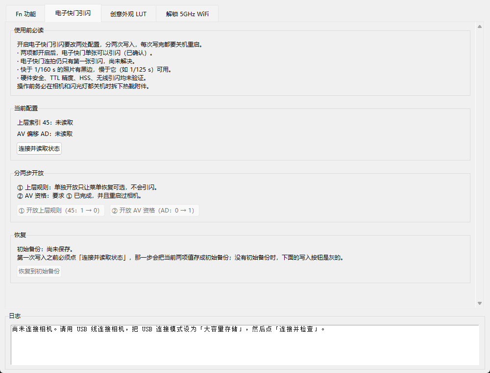

This is a second tab in the same window. It lets an electronic shutter fire a flash on the A9. **Nothing here is verified beyond what is written below, and hardware safety has not been established.**

**Do this with the camera and the flash both switched off. Take the hot-shoe flash off before connecting.** Put it back only after the app has exited and the camera has been power-cycled and disconnected.

### What is known

| Situation | Result |
|---|---|
| Electronic shutter, single shot, both settings open | Fires the flash |
| Electronic shutter faster than 1/160 s | Black band in the frame |
| Electronic shutter at 1/125 s or slower | Full-frame illumination reported by the user |
| Mechanical shutter continuous | Fires every frame |
| Electronic shutter continuous | **First frame only**; the flash icon then greys out |
| Hardware safety, TTL accuracy, HSS, wireless | Not verified |

### Step 1 — Read, which also saves the baseline

Switch to the **电子快门引闪** tab and click **连接并读取状态**.

Two values appear: the upper-layer rule (`45`) and the AV eligibility byte (`AD`). **The first successful read also writes a baseline into `sessions\flash_baseline\`.** That baseline is what the restore button puts back. Until it exists, both write buttons stay grey on purpose — you cannot reach a state you have no way to undo from the same window.

### Step 2 — Open the upper-layer rule  ⚠

With `45 = 1`, click **① 开放上层规则（45：1 → 0）**. Confirm the dialog. Wait for `SAVED_AND_READBACK_VERIFIED` in the log.

**Power-cycle the camera.** This step alone does not make the flash fire — it only makes the menu item selectable again.

### Step 3 — Open the AV eligibility  ⚠

Reconnect, read the state again (it should show `45 = 0`), then click **② 开放 AV 资格（AD：0 → 1）**. Confirm. Wait for the same success line, then **power-cycle again**.

With both open, single-frame electronic shutter fires the flash.

### Step 4 — Undo

Open the tab and click **恢复到初始备份**. It writes both properties back to the values captured on the first read and tells you which ones actually needed restoring. If the baseline was recorded on a different camera body, it refuses.

### Why it takes two connections

Each of the two settings is guarded by its own packet allowlist, and neither guard permits the other's property. The tab therefore opens a fresh connection per step, and closes the Fn session first. A read or a write takes about as long as the connect step in the Fn tab.

## Creative Look LUT  ⚠ replaces a 300 MiB partition

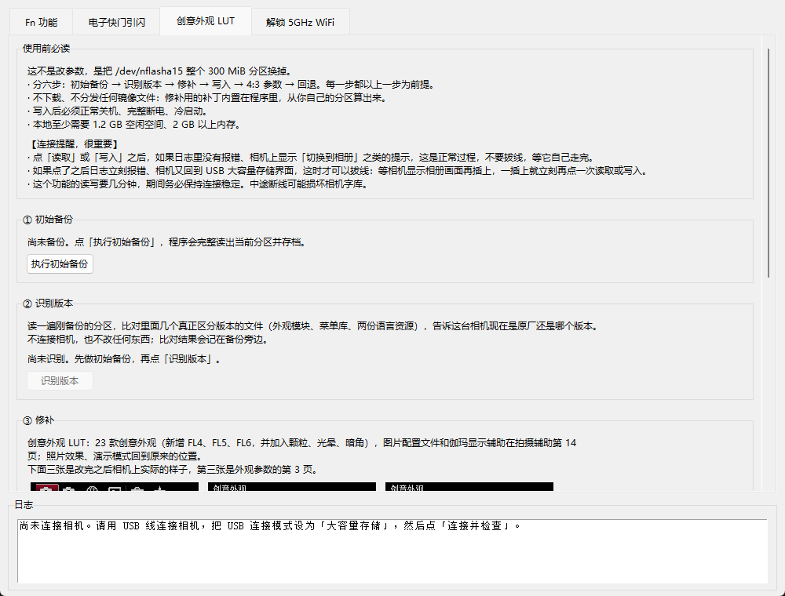

> **Status (2026-11-17): the read/write channel is verified on hardware.** A 300 MiB partition read completed on a camera, and the data matched the release image block for block — apart from the 13 bytes of ext2 mount counters and timestamps the camera rewrites at every boot. Confirm you know your rollback before patching or writing.

The third tab replaces the whole `/dev/nflasha15` partition. **This is not a parameter change.** It replaces the partition that holds `/usr`, and a previous attempt with a different layout left the camera cold-starting with no menu at all (that build is withdrawn).

**No image is shipped or downloaded.** The tool reads the camera's own partition, checks it is byte-identical to the factory build, applies the built-in patch, and verifies the result against the candidate SHA256 — all locally, before anything is written. Two hashes pin both ends: `ed835ff9…` going in, `5c0aeb95…` coming out. A partition in any other state is refused, not overwritten.

That build (called R12 internally) contains: **23 Creative Looks** with grain, halo and vignette, plus Picture Profile and Gamma Display Assist moved onto page 14 of Shooting Assist, alongside the existing four aspect ratios and creative-style entry. 照片效果 and 演示模式 return to the slots PP and the display assist had been occupying.

### After the backup it names the build

Once the partition is read, the tool opens it, pulls out the files that actually
differ between releases (`lib/a9fl.so`, `lib/viewUnified2.so`,
`lib/CautionConfig.so`, both language resources), and compares them against a
bundled fingerprint. It then tells you which of **原厂 6.00 / R8 / R9.1 / R10 /
R11 / R12** the camera is on.

**Why not a whole-partition hash**: the camera rewrites ext2 mount counters and
timestamps at every boot, so the same build hashes differently each time. Those
files do not change — which also means a dump taken long after the flash is
still identifiable.

| Result | Meaning | Next step |
|---|---|---|
| 原厂 6.00 | untouched | safe to patch |
| R12 | already the target | nothing to do |
| R8 / R9.1 / R10 / R11 | older build | roll back to factory first, then patch |
| matches nothing | changed by another tool | the tool will not touch it, and lists the files that differ |

### What the image does and does not carry

The partition holds firmware, not camera identity. On the machine this was verified on, the live partition's first 221,609,984 bytes were **byte-identical to the official firmware's `nflasha15`** — no serial, no calibration, no per-body data lives there.

So the image is portable across ILCE-9 bodies at 6.00. **The features are not.** Opening 4:3 and saving it also needs the companion parameters in `/setting/Backup.bin` (`nflasha2`), which are per-body. A transplanted menu on a body without those parameters will show the entries but not complete the save chain.

### Step 1 — Back up, patch, write — in that order

The tab is five numbered steps. **Each button stays disabled until the step before it is done.**

1. **① 初始备份** — read the whole partition and archive it. Read-only; nothing is written. **Without this backup the other four steps are unavailable**, so there is no way to end up half-applied.
2. **② 识别版本** — read the backup and compare the files that differ between builds, so you know what the camera is on. No camera access.
3. **③ 修补** — build the target image locally from that backup. The result must hash to `5c0aeb95…` or it stops. The camera is not touched. Enabled only when the backup identified as factory.
4. **④ 写入相机** — read the live partition once more for the record, write the whole partition in one transfer, read it back to verify.
5. **⑤ 写入 4:3 保存参数** — see the note below.
6. **⑥ 回退到初始备份** — write the step-1 backup back at any time.

**The first backup can be retaken.** Pressing ① asks first: if the camera is no longer at factory, the new backup is not a factory backup, and rolling back later returns to that state rather than to the factory one.

**There is nothing to download or pick.** The patch (51,005 runs, ~1.4 MB) ships inside the program and applies to the partition you read out of your own camera.

**Budget 1.2 GB of free space** per operation: one archive of the current partition, one readback. Allow 2 GB of RAM too — the patch step holds the partition in memory while it rewrites it.

> This build does not upgrade from the older "Menu" or "Creative Look FL" images. If your camera is still on one, the tool says so and points you at **⑥ 回退** first.

> **What the light on the camera tells you**
>
> - Press **读取** or **写入**: if the log shows no error and the camera says it is switching to the album, that is the normal path — **do not unplug**, let it finish.
> - If the log errors out immediately and the camera drops back to USB Mass Storage, then you may unplug: wait for the camera to show the album, plug back in, and press the same button again right away.
> - These transfers take minutes. Keep the connection stable — **pulling the cable mid-transfer can corrupt the camera's font data.**

**Camera on, battery charged, USB stable. Close every other program that talks to the camera.**

### Step 2 — Power cycle

Normal shutdown, full power removal, cold start. A warm restart is not enough — the partition is re-read at boot.

### Step 3 — Confirm

Reconnect, press **MENU** → shooting menu → Shooting Assist, and page to 14/14. Five entries (screenshots from the camera):

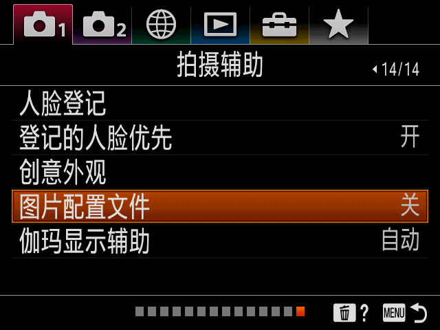

Open **Creative Look** and page to the end of the list to see the new FL4 / FL5 / FL6:

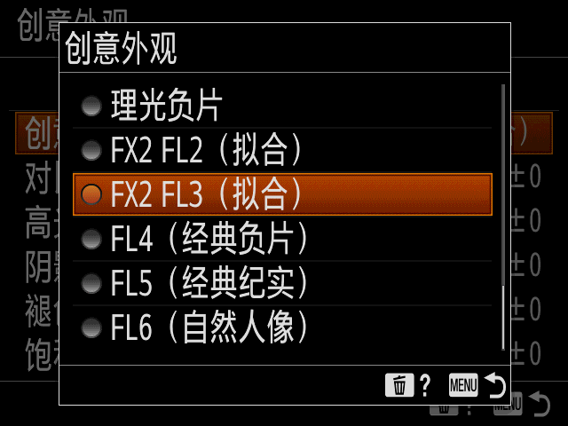

Page 3 holds the three R12 additions — grain, halo and vignette:

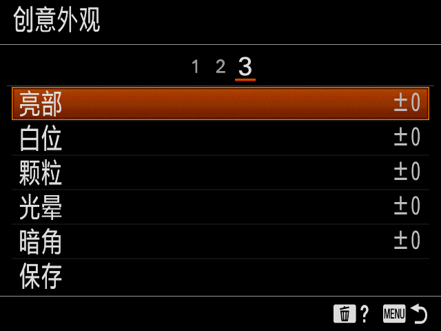

照片效果 should be back at Shooting 1 page 12, and 演示模式 back in the Setup menu — both had been displaced by PP and the display assist.

### Step 4 — 4:3 save parameters

The four ratio entries live in the partition, but the menu alone is not enough. Selecting 4:3 and actually saving also needs 51 output-size, pixel-count and JPEG-capacity parameters written to `/setting/Backup.bin` on `nflasha2` — that file is per-body and not part of the partition.

**This step is a parameter write, not a partition swap.** It records the current values first, and can be restored on its own.

### Undo

**回退到初始备份** writes the partition captured before the first deploy back to the camera. It refuses if that backup is missing or damaged.

If you also wrote the 4:3 parameters, restore them separately from the record that step left behind — it is an independent change.

### Colour chart for the 23 looks

R12's real colour tables rendered outside the camera: one set of 24 standard
patches through the factory baseline and through each of the 23 looks. Every
patch is computed per pixel with the reconstruction in upstream
`classic_look_preview.py::sample` — Rec.709-style RGB/YCC interpretation, a
5x9x9 grid with trilinear interpolation, gamut clipping, 8-bit output. It is
**not** one averaged filter applied to the whole card, and no Lab average is
pasted into HSV. The factory column goes through the same model and the real
stock tables rather than an untreated input card.

**This is a colour-table preview, not a shot JPEG.** Actual output also depends
on white balance, exposure, creative style and colour management; passing on
hardware does not make this RGB simulation chromatically calibrated.

The full 24-panel chart is at the top of this page. Below, the same thing
in four pages of six:

| | |
|---|---|
| 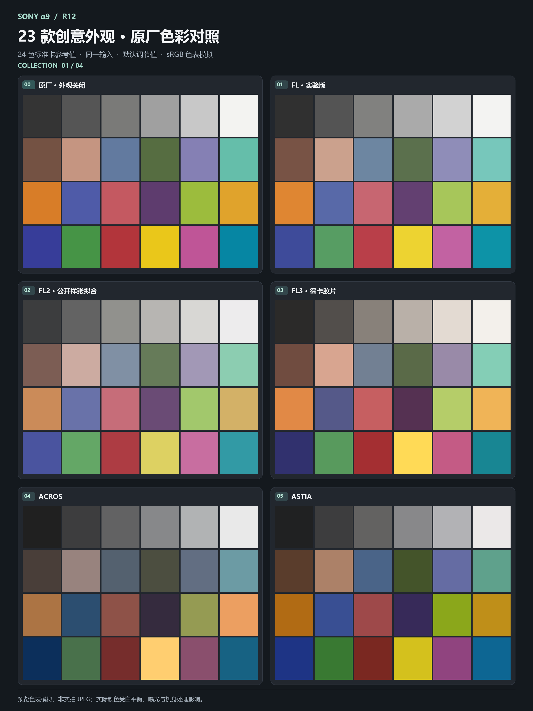 | 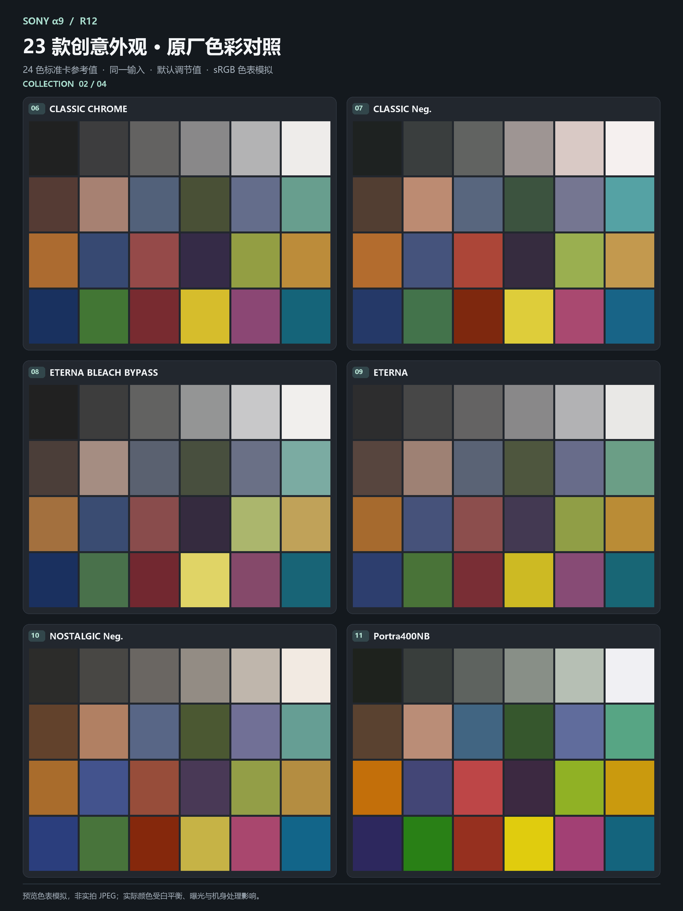 |
| 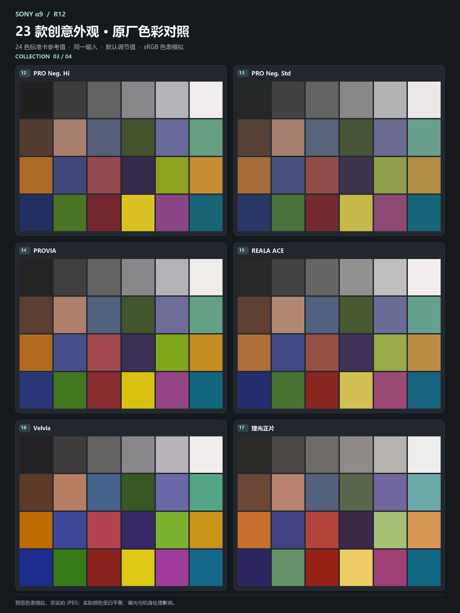 | 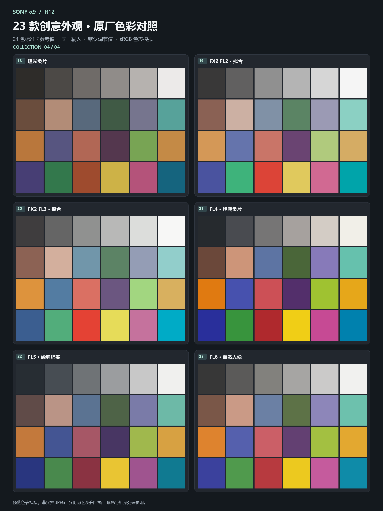 |

### Known limits

- The 23 looks and the menu layout are accepted on hardware; **the colours are not equivalent to Sony, Fujifilm or Ricoh originals** — the 17 new ones are experimental fits.
- **4:3 JPEG does not work** — the size submenu has no options and the free-frame count reads 0. 4:3 RAW saves once the companion parameters are applied.
- The new menu entries target the `0x4B` layout; `0x4C` keeps its existing organisation.
- A whole-partition readback will not match the image byte for byte: the camera rewrites ext2 mount counters and timestamps at boot. File contents do match.

## Unlock 5 GHz Wi-Fi  ⚠ writes to the camera's configuration

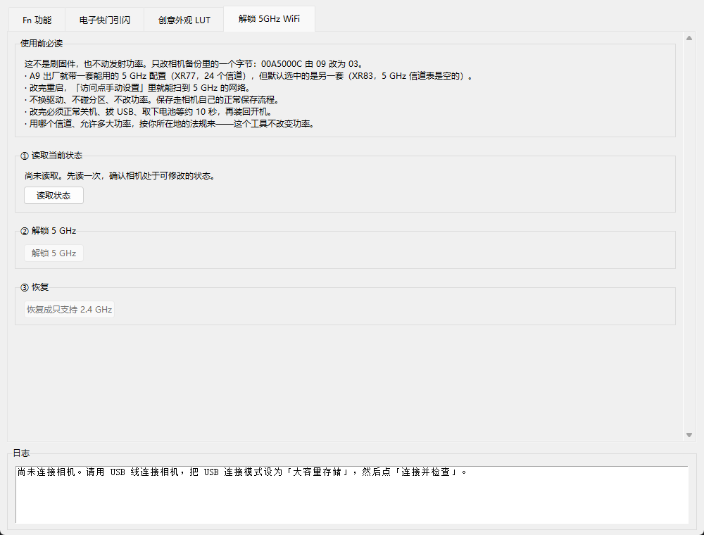

The fourth tab lets the camera join a **5 GHz** access point. It changes one byte in the camera's backup — not firmware.

**Why one byte is enough.** The A9 ships with two radio-regulatory configurations. The one it selects by default (XR83) has an **empty** 5 GHz channel list, so the camera never offers 5 GHz to an ordinary router. The other (XR77) is already on the camera with 24 usable channels (36–64, 100–140 step 4, and 149/153/157/161/165). Moving the selector from `09` to `03` makes the camera use the configuration it already carries.

**Nothing is downloaded or replaced**: no partition image, no driver, no menu library. The change goes through Sony's own Backup service and is persisted with the camera's normal save path.

### Doing it

1. Camera on, USB in Mass Storage, this camera only. **Set up a 5 GHz-only test SSID** (different name from the 2.4 GHz one) on a channel your region allows; 20 MHz, WPA2-PSK/AES is the least fiddly.
2. Open the **「解锁 5GHz WiFi」** tab → **「① 读取状态」**. It reads six properties and keeps a full backup. You need to see `00A5000C = 09` before going on.
3. Press **「② 解锁 5 GHz」** and confirm.
4. Shut down normally, unplug USB, **take the battery out for about 10 seconds**, put it back and power on.
5. Camera → Network → Wi-Fi Settings → Access Point Manual Setting, and scan. The 5 GHz SSID should appear.

**Seeing the SSID is not the test.** Register it, run the FTP entry that already worked on 2.4 GHz, then check on the router that the camera is actually associated at 5 GHz, on which channel, with which IP — and transfer a small file. Finally power-cycle completely and reconnect via FTP without opening the settings page first.

### Undoing it

**「③ 恢复成只支持 2.4 GHz」** writes `00A5000C` back to `09`, again through the normal save. Nothing else changes — PP, S-Log and Creative Look settings are untouched, because only this one byte moves.

### Known limits

- **Power is unchanged.** This selects a configuration; it does not raise transmit power or touch calibration. Which channels and how much power are legal is a question about where you are.
- Verified on one body: 5 GHz association, FTP over channel 161, reconnect after a full power cycle, and a 2.4 GHz regression. Channel 44 association, Direct / TV / multi-camera modes and long-run stress were **not** tested.
- A normal save may also update the backup file's own counters and checksums, so do not expect the file to differ in exactly one byte.
- The change requires `00A5000B=09`, `013E0061=0000`, `01071563=00`, `00A50009=00` and `00A5000A=00` to still hold their factory values. If any has moved, the tool refuses and tells you which.

## Force rollback  ⚠ the official package rewrites the firmware

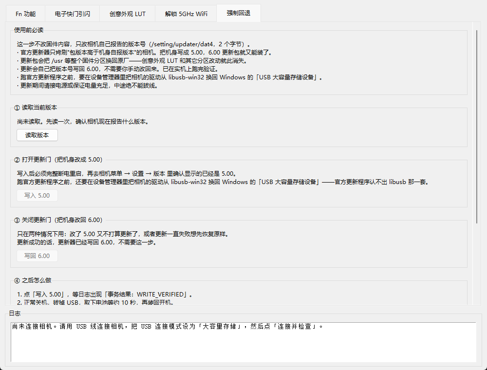

The fifth tab takes the camera back to factory **as a whole** — not one partition restored from a backup, but Sony's own updater rewriting the firmware.

**Why it is needed**: the Creative Look LUT replaces a whole partition, and rolling back writes back "the copy you read out at the start". If that copy was not factory to begin with (you switched builds in between), or if what you want is a clean, factory-identical firmware, the only reliable route is to let the official package install over it.

**What it changes**: `/setting/updater/dat4`, two bytes, a little-endian BCD version string. It is not a copy of anything — it is where the value in the camera's own MENU → Setup → Version comes from. Checked on hardware: with it set to 5.00, every service-mode connection that requires 6.00 was refused, which proves this is the source.

The official updater only installs when the package version is higher than the version the body reports, so writing 5.00 makes the 6.00 package installable again. That update rewrites `nflasha15` (/usr), `nflasha3`, `nflasha5` and `nflasha7` back to factory.

### Doing it

1. Open the **Force rollback** tab → **Read version**. Only continue if it says `6.00` (`dat4 = 00 06`).
2. Click **Write 5.00** and confirm.
3. Power off normally, unplug USB, **remove the battery for about 10 seconds**, then power on.
4. **On the camera: MENU → Setup → Version must now say 5.00.** If it still says 6.00, the write did not take — come back, click Read version, and check what `dat4` actually holds. **Do not go on to the update.**
5. **Put the camera back on Windows' own "USB Mass Storage Device" driver.** The official updater cannot see a libusb device. Device Manager → expand **libusb-win32 devices** → right-click `ILCE-9` → **Update driver** → **Browse my computer for drivers** → **Let me pick from a list of available drivers on my computer** → tick **Show compatible hardware** → select **USB Mass Storage Device** → Next and wait for it to finish. When the memory card reappears in Explorer, the switch is done. This is the same procedure as [restoring the camera to Windows](#restoring-the-camera-to-windows).
6. Connect the camera by USB in Mass Storage mode and run Sony's official 6.00 updater to completion.
7. When it finishes the body reports 6.00 again (the updater writes it back), and the Creative Look LUT and every other partition change is gone.

**Use mains power or a full battery, and never unplug during the update.**

### Undoing it

If you write 5.00 and change your mind, or the update keeps failing, **Write 6.00** puts the version back. A successful update does not need this.

### Known limits

- **Settings are very likely reset too.** The official package carries a factory `Backup.bin` (1,090,266 bytes, `0110_backup/…/CX79900_UC2.bin`) and `endupdate.sh` copies it over `/setting/Backup.bin` as it finishes. Fn slots, the 5 GHz byte and the 4:3 parameters therefore probably return to their defaults — **that has not been checked property by property on a body.** If something turns out not to have moved, the Fn and 5 GHz tabs have their own restore buttons.
- **Exactly one full path is verified**: on 2026-11-17, on this project's own camera, writing 5.00 → the official 6.00 package ran to completion → the version returned to 6.00 by itself. An update that fails part-way, a power cut, or unplugging mid-flash have never been tried.
- ILCE-9 only. The `dat4` encoding looks identical on the A7R IV A from static inspection, but **nothing there has been tested on hardware**, and this tool does not support that model.

## If something goes wrong

| Log message | Meaning | What to do |
|---|---|---|
| `Service device not found` | Camera is in service mode, Windows has no driver for that device | Step 5 |
| 没有找到相机 | No camera matched | Check Mass Storage mode, driver from step 3, cable |
| 找到多台相机 | More than one camera plugged in | Unplug the others |
| `Camera busy during identity request` | Camera reported busy | Power-cycle the camera, close Imaging Edge and similar software, reconnect |
| 只支持 ILCE-9 固件 6.00 | Wrong model or firmware | Nothing to do — the app refuses by design |
| `Pipe error` while reading the camera | The transfer broke part-way; the camera may have dropped off USB | Power-cycle, replug. **If it breaks at the same byte every time, stop retrying** and post the log in Issues |
| `FAILED_REVIEW_REQUIRED` (inside `sessions/…/journal.json`) | A write failed part-way | Keep the `sessions` folder; the camera may have a partial change. Restore from the app before retrying |

Every write records a journal in `sessions/<timestamp>/` next to the exe. If you ask for help, include that file's `state` and `error` fields plus the log from the bottom of the window — **not** the whole `Backup-original.bin`, which contains camera configuration data.

---

## Safety

Every write saves a full backup and a transaction journal next to the executable **before** touching the camera, and every write can be undone from the app.

This is not a Sony tool. Modifying camera parameters may void your warranty. Use it on your own camera, at your own risk.

---

## Building

Build-time only; end users need nothing installed.

```powershell
pip install pyinstaller
powershell -File build/build_exe.ps1
```

Output: `dist/ILCE-9_Slog_Project.exe` (~15 MB, onefile, unsigned).

Verify the bundle without a camera:

```powershell
$env:A9TOOL_CONSOLE=1
python -m PyInstaller build/a9tool.spec --clean --noconfirm
$env:A9TOOL_SELFCHECK=1; .\dist\ILCE-9_Slog_Project.exe
```

A windowed exe has no console, so build with `A9TOOL_CONSOLE=1` to read the output. It checks the JSON tables, the sessions path, the bundled libusb backend, and that the main window constructs with all 77 rows.

## Publishing a release

**The exe is not in git.** `.gitignore` excludes it, so a Release built from the repository alone has no download. `build/entry.py` is what the workflow runs.

Push a tag:

```bash
git tag v1.0.0
git push origin v1.0.0
```

`.github/workflows/release.yml` then runs the tests, builds, self-checks the bundle, and attaches `ILCE-9_Slog_Project.exe` plus `SHA256SUMS.txt` to the Release. Re-running the workflow for the same tag replaces the attached files.

**Release notes**: drop a file at `docs/releases/<tag>.md`. The workflow takes its first heading as the Release title and the whole file as the body; without one it falls back to GitHub's generated commit list.

To publish a build you made locally instead: GitHub → **Releases** → **Draft a new release** → upload `dist/ILCE-9_Slog_Project.exe`.

## Tests

```powershell
python -m unittest discover -s tests -t .
```

All tests are offline: a `FakeCamera` stands in for the real device, so no camera and no USB backend is needed. 236 tests, including Tk widget-state checks and a subprocess check that the vendored stack imports with site-packages disabled.

## How it works

The saved byte in an Fn slot is resolved by `viewUnified4.so`'s switch table into an internal node id, then looked up in the Fn runtime root array. That path does not consult the main menu tree, which is why Fn entries work while the settings menu still has no Picture Profile node. The resolver rejects any byte above `0x6E` before the lookup.

The PP feature-override property (`0x00880000`, five offsets set to `0x02`) must be enabled first, or the PP-dependent entries resolve to nothing.

## Acknowledgements

The 5 GHz unlock follows — and is cross-checked against — **[dino2048/ZV-E10-5GHz-WiFi-Unlock](https://github.com/dino2048/ZV-E10-5GHz-WiFi-Unlock)**. That project targets the ZV-E10; none of its menu-library offsets or property values were copied, because the two cameras differ in configuration numbering, menu-library size and available configurations. The A9 uses its own selection mechanism (`00A5000C` → XR77).

**The 17 new Creative Looks are colour-matched from [Erlla/sony-a7m4-custom-firmware](https://github.com/Erlla/sony-a7m4-custom-firmware).** Its LUT and look definitions are what this project fitted against. The implementation on the A9 is a re-adapted dual-source property scheme, not a copy of their files.

The menu-transplant approach follows **[robinshie/Sony_A7M3](https://github.com/robinshie/Sony_A7M3)** (MIT), pinned at commit `e6bbfafb55570a5de34e75c195e7e1c780d03340`.

Its key insight is what made the transplant work here: attach the change to the **real menu-creation call**, not to `DT_INIT`. An earlier attempt that patched at init time wrote and read back correctly, yet the menu after a restart was unchanged. Everything else — function addresses, property record lengths, the layout of the new entry, the sector-level storage plan — was re-located and re-verified against this camera's own firmware rather than copied, because the A7 III reference differs on every one of those points.

The electronic-shutter flash gates and the PP/Fn slot path come from the research in this repository's `analysis/` tree; their reports are cited in the delivery notes.

## Licence

MIT — see [LICENSE](LICENSE). Third-party components and the origin of the firmware-derived tables are listed in [NOTICE](NOTICE).

A screenshot-illustrated version of this guide is in `docs/` (`docs/index.html`, `docs/zh-CN/index.html`) — open the file directly in a browser; the images are placeholders until someone takes them on a real machine.
