# ILCE-9_Slog_Project

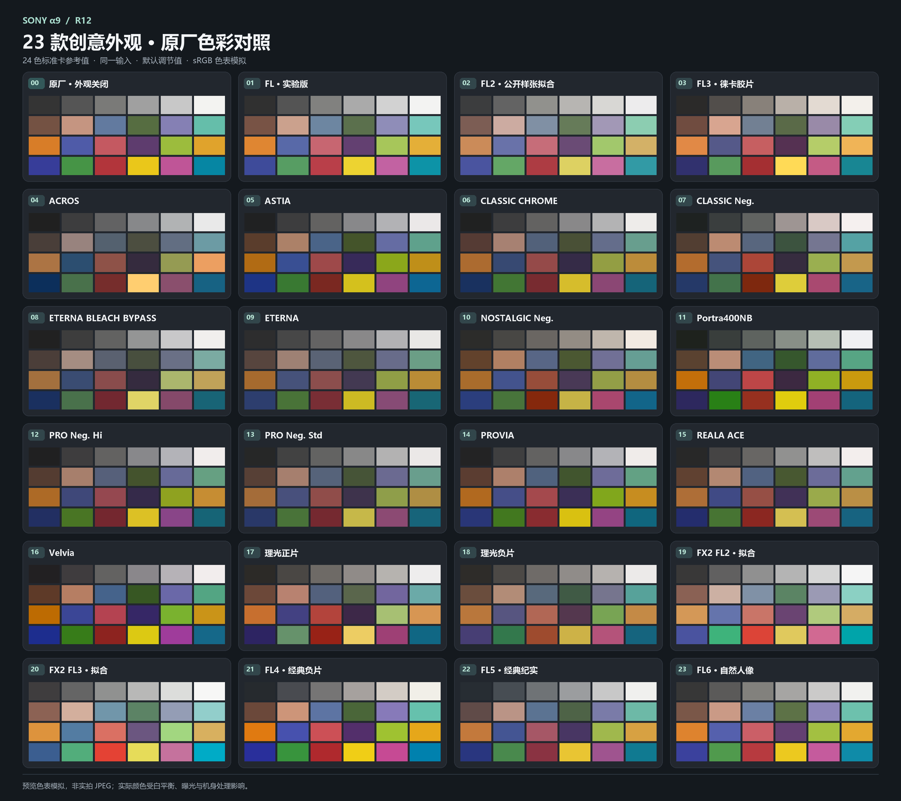

把 Picture Profile（图片配置文件）和 SLog 显示辅助放进 Sony A9（ILCE-9，固件 6.00）的 Fn 菜单——顺带还有相机里本来就有、但官方界面没给入口的另外 75 个功能。

[English](README.en.md)

**图形界面新增「电子快门引闪」选项卡**：分两步开放上层规则和 AV 资格，
读取状态、执行和恢复都在窗口里完成。同样的功能也保留两个源码入口
`python -m a9tool.flash` 和 `python -m a9tool.flash_av`（默认只读）。
2026-11-11 用户确认两项配置合用后电子单张可实际引闪；电子连拍仍仅首张，
硬件安全尚未验证。步骤、恢复及限制见[交付说明](docs/FLASH_DELIVERY.zh-CN.md)。

**「解锁 5GHz WiFi」选项卡**让相机连得上 5 GHz 路由器：只改备份里的一个字节
（`00A5000C` 由 09 改为 03），让相机用它自己本来就带着的那套 5 GHz 法规配置。
不刷固件、不改功率。2026-11-16 实机确认 5 GHz 关联、FTP 传输和断电重连正常。

**「创意外观 LUT」选项卡**把 23 款创意外观装进拍摄辅助第 14 页（新增 FL4–FL6 和颗粒、
光晕、暗角），同时把图片配置文件和伽玛显示辅助也移到那里，让照片效果、演示模式回到原位。
这一版是整分区替换。它仍然不下载、不分发任何镜像：补丁在程序里，
作用在你从自己相机读出、哈希核对过的分区上。见[下面的完整步骤](#创意外观-lut--会替换整个-300-mib-分区)。

**「强制回退」选项卡**用 Sony 自己的 6.00 更新包把相机整体刷回原厂：先把相机自报的版本
改成 5.00（只改 `/setting/updater/dat4` 两个字节，不动固件内容），更新包就肯再刷一次。
更新会把 `/usr` 等固件分区整块换回原厂，创意外观 LUT 和其它分区改动随之消失；
更新跑完后版本号由更新器自己写回 6.00。见[下面的完整步骤](#强制回退--用官方更新包整机恢复)。

---

## 更新记录

### v1.8.0（2026-11-17）

**新功能**

- **新增「强制回退」选项卡**：把相机自报的固件版本由 6.00 改成 5.00，让 Sony 官方 6.00 更新包可以再刷一次。更新会把 `/usr` 等固件分区整块换回原厂，因此创意外观 LUT 和其它分区改动全部消失；更新跑完后版本号由更新器自己写回 6.00。
- 只写 `/setting/updater/dat4` 两个字节，不改固件内容。写前把原值落盘、写后逐字节回读核对，一次会话只允许一次写入，路径和长度都在白名单里卡死。
- 这个选项卡在相机报告 5.00 时也能连上（其余选项卡仍然要求 6.00），用来在临时放弃更新时把版本写回 6.00。

### v1.7.0（2026-11-17）

**新功能**

- **创意外观 LUT 目标升级到 R12**：23 款外观，新增 FL4 / FL5 / FL6，并加入颗粒、光晕、暗角。菜单布局不变。
- **备份后自动识别版本**（新增第②步）：比对分区里的外观模块、菜单库和两份语言资源，告诉这台相机是原厂 6.00 / R8 / R9.1 / R10 / R11 / R12 中的哪一个。整分区哈希会被相机开机改写的时间戳破坏，这个识别不会。
- **选项卡改成六步**：初始备份 → 识别版本 → 修补 → 写入 → 4:3 参数 → 回退。
- **初始备份可以重做**：覆盖前会说明新备份记录的是当前状态，不是出厂状态。
- 标题栏和首页显示版本号。

**修复**

- **300 MiB 分区读写通道**：`oData` 被中间层丢弃、回复上限卡在 2 MiB 且最多 3 帧、请求不分块且限制 1 MiB。结果是这个选项卡连第一步读取都完成不了。现在回复直接流式落盘，请求按 1 MiB 切包，帧数按声明总量走。真机已验证：读出的分区能与发布镜像逐块比对。
- **分区哈希拖慢界面**：每次刷新都给 300 MiB 算 SHA256，有备份之后界面明显卡顿。改为按文件大小和修改时间缓存。

### v1.6.1（2026-11-17）

**修复**

- **回退 v1.5.1 引入的回归**：v1.5.1 按产品号判断回复块之间有没有 512 字节分隔块，对一类 0x0336 机身正确，对另一类则是灾难——Fn 槽位和电子快门引闪的**所有**读写都会失败，300 MiB 读取会停在第一个 32 KB 块。现在恢复成始终读分隔块（v1.5.0 的行为，实测可用），需要另一种模式的机身用环境变量 `A9TOOL_UNPADDED=1`。

### v1.6.0（2026-11-17）

**新功能**

- **新增「解锁 5GHz WiFi」选项卡**：只改备份里的一个字节 `00A5000C`（09 → 03），让相机用它本来就带着的 XR77 无线电法规配置——出厂默认选中的 XR83 那一套 5 GHz 信道表是空的。不刷固件、不换驱动、不改发射功率。
- 实机确认：5 GHz 关联成功，路由器侧确认信道 161 并分配 IP，FTP 传输成功，完整断电后重连，2.4 GHz 回归正常。

**修复**

- 读取中途的 `Pipe error` 不再提示「换线换口」——改为说明相机可能已掉线、同一处反复失败就别再重试。
- 连接日志打印服务模式的产品号，方便定位。

## 它做什么

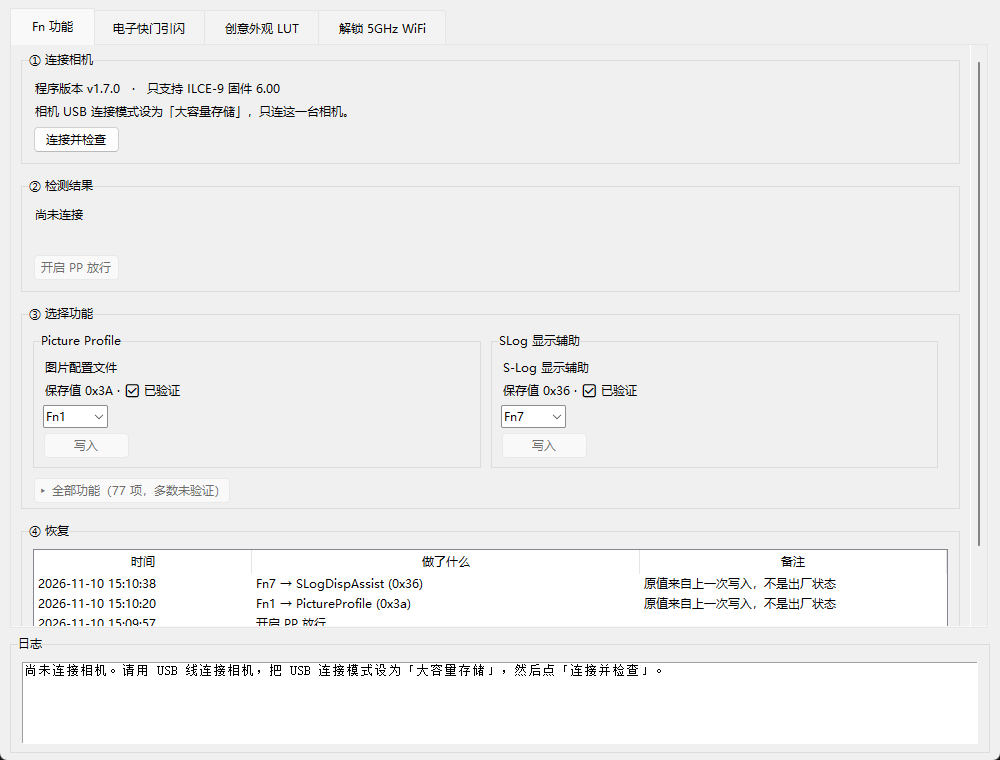

A9 里编译进了 Picture Profile 和 SLog 显示辅助，但没有菜单入口。这个工具通过索尼自己的服务模式参数接口，往十二个 Fn 槽位之一写入一个字节的保存值。相机用**自己的**函数表解析这个字节，于是入口就出现在 Fn 菜单里。**没有改固件。**

两项功能已在实机上确认可用：

| 功能 | 保存值 | 实机结果 |
|---|---|---|
| Picture Profile | `0x3A` | Fn 出现入口，录制画面变化，重启后仍在 |
| SLog 显示辅助 | `0x36` | Fn 出现入口，功能正常，重启后仍在 |

另外 75 个保存值来自相机自己的函数表，在程序里可以选。**这些都没有在实机上验证过。** 其中一个——像素转换多重拍摄（`0x64`）——已知会在拍完第一张后卡死、需要拔电池，程序里标红并会二次确认。

## 前提

- Sony **ILCE-9**，固件 **6.00**。其他机型和版本一概不支持，程序会在写入前拒绝。
- Windows 10 或 11。
- [Zadig](https://zadig.akeo.ie/)——免费、免安装。你会用到它两次。
- 一块有电的电池，一根能传数据的 USB 线（不是只能充电的线）。

---

## 一步一步做

下面是完整流程。如果你是一个 AI agent 在照着执行：**标了 ⚠ 的步骤会写入相机，请先取得使用者确认再动手。**

### 第 0 步：确认相机

相机上 **MENU → 设置 → 版本**，必须显示 **6.00**；机身必须是 **ILCE-9**（不是 ILCE-9M2）。

不符就停手。不同固件版本的参数地址不同，程序本来也会拒绝。

### 第 1 步：拿到程序

在本仓库的 **Releases** 页面下载 `ILCE-9_Slog_Project.exe`，放到一个固定的位置，比如 `C:\A9Tool\`。

没有安装程序，也没有卸载程序。第一次运行时它会在自己旁边建一个 `sessions` 文件夹存放备份，**不要删掉**。

### 第 2 步：过 Windows 这一关

双击。Windows 会弹「Windows 已保护你的电脑」，点 **「更多信息」→「仍要运行」**。

exe 没有数字签名（证书一年几百美元）。杀毒软件也可能报毒，因为它要直接访问 USB 设备。源码就在本仓库里，想确认可以自己读。

### 第 3 步：给「大容量存储」装驱动

1. 相机关机 → 插 USB 线 → 相机开机。
2. 如果相机问怎么连接，选 **「大容量存储」**。此时 Windows 资源管理器里应该能看到存储卡。
3. 打开 **Zadig**。
4. **Options → List All Devices**。
5. 在下拉列表里选中你的相机，可能显示为 `Sony Digital Still Camera` 之类。
6. 确认右侧目标驱动是 **libusb-win32**，不是的话点箭头切换。
7. 点 **Install Driver**（或 **Replace Driver**），等它完成。

> **不要选中 `USB Input Device` / VID `054C` PID `0994`。** 那是相机的 USB *输入*接口，不是本工具要操作的那个。改错了会让电脑上的输入设备出问题。

**会看到：** 之后资源管理器里看不到存储卡了，还可能弹「需要格式化」。

**这是正常的，不要格式化。** 文末「把相机还给 Windows」一节讲了怎么恢复。

### 第 4 步：连接

1. 双击 `ILCE-9_Slog_Project.exe`。打开一个窗口，从上到下四个编号区域，底部是日志。
2. 点 ① 区的 **「连接并检查」**。

**正常的话，日志里会出现：**

```
已确认 ILCE-9 / 6.00，正在切换服务模式
服务模式已认证，正在读取机身参数
```

然后 ② 区填上机型、固件、序列号指纹。

**如果日志说 `Service device not found`**：看第 5 步。

**如果日志说「没有找到相机」**：相机没在「大容量存储」模式，或第 3 步的驱动没装好，或线是只能充电的线。

### 第 5 步：再装一次驱动（只在第 4 步失败时）

服务模式是一个**不同的 USB 设备**，需要单独再装一次驱动。这是正常现象。

1. 相机不要拔线，保持现在的状态。
2. 再打开 **Zadig** → **Options → List All Devices**。
3. 列表里会多出一个新的 Sony 设备，名字里通常带 `(Interface 1)`。
4. 同样给它装 **libusb-win32**。
5. 回到程序窗口，点 **「重试」**。

> 重试凭据一小时后失效。失效了就拔掉相机、回到大容量存储模式，从第 4 步重来。这一步还没写入任何东西，重来是安全的。

### 第 6 步：开启 PP 放行  ⚠ 会写入相机

② 区显示 **PP 放行：✗ 未开启**。

点 **「开启 PP 放行」**，确认，等待日志出现成功信息。

这一步写一个 1024 字节属性里的**五个字节**，**不碰任何 Fn 槽位**。

**然后关机重启相机。** 这些参数只在开机时重新读取，不能跳过。

**如果 ② 区显示 ⚠ 状态异常**：五个字节只改了一部分，程序拒绝写入。用 ④ 区的 **「恢复全部原厂」**，或者重来。

### 第 7 步：把功能写进槽位  ⚠ 会写入相机

重新打开程序，重复第 4 步连接（这次不用再装驱动）。

③ 区有两个卡片：**Picture Profile** 和 **SLog 显示辅助**。每张卡片下面有槽位下拉（**Fn1**…**Fn12**）和一个写入按钮。

1. 选一个槽位。
2. 点 **「写入」**。
3. 确认。

要用别的功能，点 **「▸ 全部功能（77 项，多数未验证）」** 展开列表，选一行、选槽位、点「写入所选功能」。

**会看到：** 日志出现成功信息，然后**窗口里所有写入按钮变灰**。这是故意的——一次运行只做一次修改，每次修改都有自己的备份。要再改一个槽位，关掉窗口重新打开。

**然后关机重启相机。**

### 第 8 步：在相机上确认

按 **Fn**，你写入的那个槽位应该变成了对应的功能。

> **「菜单里出现了」不等于「功能能用」。** 十二个槽位都能写进去，相机也都会显示——但显示出来只说明入口存在。Picture Profile 和 SLog 显示辅助是确认能用的；另外 75 个从来没人试过，可能灰显、没反应，甚至卡死。

### 第 9 步：改回去

**撤销一次修改：** ④ 区列出你做过的每一次修改，带时间。点选一行 → **「从备份恢复到原状」** → 重启相机。

每行的「原值」是**那一次修改之前**的值。如果你连着改了几次，撤销第二次只会回到第一次改完的状态，不是出厂状态。列表里会给这类记录加备注。

**全部恢复：** **「恢复全部原厂」** 会把本工具碰过的所有位置写回第一次使用前的值。它也会覆盖你在相机上手动改过的设置。

### 把相机还给 Windows

不用这个工具了，或者需要让官方更新程序、资源管理器重新认出相机时：

1. 关掉程序。
2. 右键「开始」→ **设备管理器**。
3. 展开 **libusb-win32 devices**，右键下面的 `ILCE-9`。
4. **更新驱动程序** → **浏览我的电脑以查找驱动程序** → **让我从计算机上的可用驱动程序列表中选取**。
5. 勾选 **显示兼容硬件**，在列表里选中 **USB 大容量存储设备**，点 **下一步**，等它装完。
6. 资源管理器里重新出现存储卡，就说明换回来了。

只改相机那一条，别动别的 USB 设备。

---

## 电子快门引闪  ⚠ 会写入相机

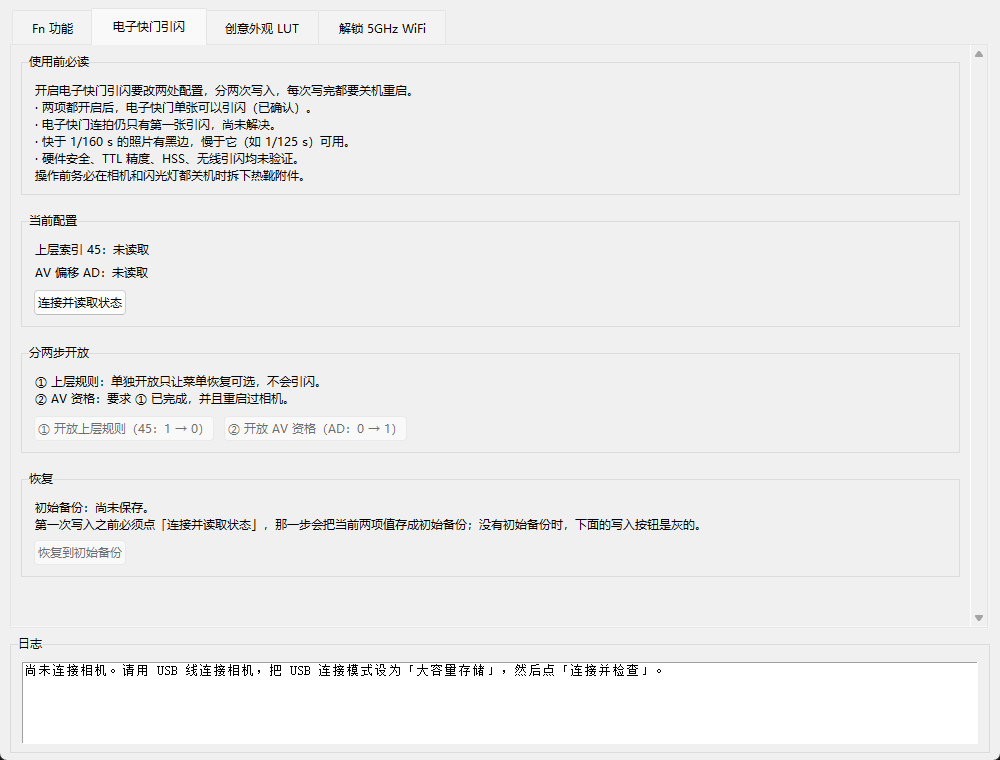

这是同一个窗口里的第二个选项卡，用来让 A9 的电子快门能引闪。**下面写到的以外都没有验证过，硬件安全也尚未证实。**

**操作时相机和闪光灯都要关机。连接之前先把热靴上的闪光灯拆下来**，等程序退出、相机重启并断开 USB 之后，再装回去。

### 已知情况

| 场景 | 结果 |
|---|---|
| 电子快门、单张、两项都开启 | 可以引闪 |
| 电子快门快于 1/160 s | 照片有黑边 |
| 电子快门 1/125 s 或更慢 | 用户报告全幅照明可用 |
| 机械快门连拍 | 每张都能闪 |
| 电子快门连拍 | **只有第一张**，之后图标变成禁止闪光 |
| 硬件安全、TTL 精度、HSS、无线引闪 | 未验证 |

### 第 1 步：读取，同时保存初始备份

切到 **「电子快门引闪」** 选项卡，点 **「连接并读取状态」**。

界面上会出现两个值：上层规则（`45`）和 AV 资格字节（`AD`）。**第一次读取成功时，程序会把这两项存成初始备份**，放在 `sessions\flash_baseline\`。恢复按钮认的就是这份文件。在它存在之前，两个写入按钮一直是灰的——不让你进入一个没法从这个窗口退回去的状态。

### 第 2 步：开放上层规则  ⚠

当 `45 = 1` 时，点 **「① 开放上层规则（45：1 → 0）」**，确认弹窗，等日志出现 `SAVED_AND_READBACK_VERIFIED`。

**然后关机重启相机。** 单独做这一步不会引闪，只是让菜单项恢复可选。

### 第 3 步：开放 AV 资格  ⚠

重新连接、再读一次状态（此时应显示 `45 = 0`），然后点 **「② 开放 AV 资格（AD：0 → 1）」**，确认，等到同样的成功提示，**再关机重启一次**。

两项都开启后，电子快门单张就能引闪。

### 第 4 步：改回去

打开选项卡，点 **「恢复到初始备份」**。它会把两项都写回第一次读取时的值，并告诉你实际恢复了哪几项。如果这份备份是在另一台机身上记的，它会拒绝执行。

### 为什么要点两次连接

两处配置各自有一套报文白名单，互相不认对方的属性。所以选项卡每做一步都要重新建立一次连接，并且会先断开 Fn 那边的会话。读一次或写一次，耗时和 Fn 选项卡里的「连接并检查」差不多。

## 创意外观 LUT  ⚠ 会替换整个 300 MiB 分区

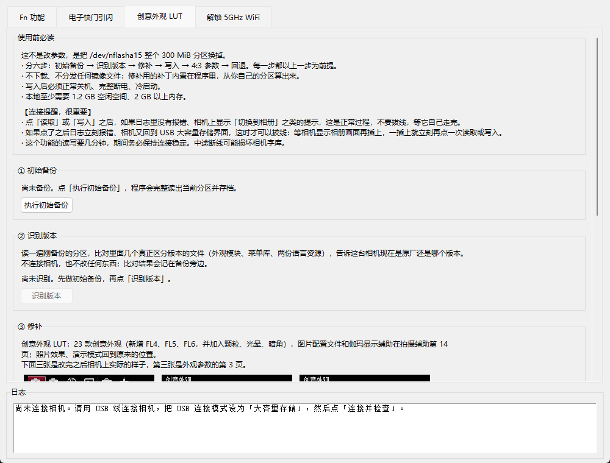

> **状态（2026-11-17）：读写通道已实机验证。** 300 MiB 分区读取在真机上跑通，读出的数据精确到能与发布镜像逐块比对（只差相机运行时改写的 13 字节 ext2 时间戳）。修补和写入仍建议先确认你知道怎么回退。

第三个选项卡替换整个 `/dev/nflasha15` 分区。**这不是改参数。** 它替换的是装 `/usr` 的那个分区，而此前一个不同布局的版本导致相机按 MENU 毫无反应、整机冷启动——那个版本已停用。

**不打包、也不下载任何镜像。** 工具直接读相机自己的分区，确认它与原厂逐字节一致，在本地应用内置的补丁，再算出 SHA256 与候选值比对，全部通过才写入。两头都有哈希钉住：进去时是 `ed835ff9…`，出来必须是 `5c0aeb95…`。分区处于任何其他状态都会被拒绝，而不是覆盖。

这个目标版本（内部编号 R12）带来的是：**23 款创意外观**（含新增的颗粒、光晕、暗角），加上**图片配置文件**和**伽玛显示辅助**并入拍摄辅助第 14 页，以及既有的四项比例和复古衣橱。原本被这两项占用的**照片效果**和**演示模式**回到各自的原始位置。

### 备份后会告诉你是哪个版本

读完分区，程序会打开它，取出几个真正区分版本的文件（`lib/a9fl.so`、`lib/viewUnified2.so`、
`lib/CautionConfig.so`、两份语言资源），和内置的指纹比一遍，然后告诉你这台相机现在是
**原厂 6.00 / R8 / R9.1 / R10 / R11 / R12** 中的哪一个。

**为什么不用整分区哈希**：相机每次开机都会改写 ext2 的挂载计数和时间戳，所以同一个版本
在不同时间读出来哈希都不一样。那几个文件的内容则不会变，这也意味着——**刷完之后过了很久再备份，
依然能认出来**。

| 识别结果 | 含义 | 下一步 |
|---|---|---|
| 原厂 6.00 | 没动过 | 可以修补 |
| R12 | 已经是目标版本 | 不需要做任何事 |
| R8 / R9.1 / R10 / R11 | 旧版本 | 先「⑥ 回退」到原厂，再修补 |
| 对不上任何一个 | 被别的工具改过，或者文件被动过 | 程序不会碰它，会列出是哪几个文件对不上 |

### 这个分区里有什么、没有什么

分区装的是固件，不是机身身份。在验证过的那台机身里，现场分区的前 221,609,984 字节与官方固件里的 `nflasha15` **逐字节相同**——里面没有序列号、没有校准、没有任何按机身唯一的数据。

所以镜像可以在同为 6.00 的 ILCE-9 之间通用。**但功能不能。** 打开 4:3 并保存，还需要 `/setting/Backup.bin`（`nflasha2`）里配套的参数，而那是按机身存的。把菜单移植到没有这些参数的机身上，入口会出现，保存链走不完。

### 第 1 步：备份 → 修补 → 写入

选项卡从左到右就是这五步，**前一步没做完，后一步的按钮是灰的**。

1. **① 初始备份** — 完整读出当前分区并存档。只读，不写相机。**没有这份备份，后面四步全部不可用**，也不会生成什么「半套」状态。
2. **② 识别版本** — 读一遍备份，比对里面几个真正区分版本的文件，告诉你这台相机现在是什么状态。不连相机。
3. **③ 修补** — 在本地用这份备份算出目标镜像，哈希必须等于 `5c0aeb95…` 才算成功。分区不动。只有识别为原厂时才能点。
4. **④ 写入相机** — 再完整读一次现场存档，然后一次性写入整个分区，写完回读校验。
5. **⑤ 写入 4:3 保存参数** — 见下面的说明。
6. **⑥ 回退到初始备份** — 随时可以退回第 1 步存下的原厂状态。

**初始备份可以重做。** 点「① 执行初始备份」时会先确认：如果相机现在已经不是原厂，新备份就不是原厂——之后「回退」会退到现在的状态，而不是出厂状态。

**没有要下载或选择的文件。** 补丁（51,005 段、约 1.4 MB）内置在程序里，作用在你自己读出来的分区上。

**每次操作预留 1.2 GB 空闲空间**：一份当前分区存档，一份回读结果。内存建议 2 GB 以上——「修补」那一步会把分区读进内存再改写。

> 这个版本不再从旧的「菜单修改」「创意外观 FL」两个版本升级。如果你的相机还停在旧版，程序会直接告诉你：先点 **⑥ 回退** 写回初始备份，再重新修补。

> **连接状态怎么判断（很重要）**
>
> - 点「读取」或「写入」之后，**日志里没有报错、相机上显示「切换到相册」之类的提示**——这是正常过程，**不要拔线**，等它自己走完。
> - 如果点了之后**日志立刻报错、相机又回到 USB 大容量存储界面**——这时才可以拔线：等相机显示相册画面再插上，**一插上就立刻再点一次**读取或写入。
> - 这个功能的读写要几分钟，期间务必保持连接稳定。**中途断线可能损坏相机字库。**

**相机关机后重新开机、电量充足、USB 稳定。关掉其他占用相机的程序。**

### 第 2 步：断电重启

正常关机、完整断电、冷启动。热重启不够——分区是在开机时才重新读取的。

### 第 3 步：确认

重新连接，按 **MENU** → 拍摄菜单 → 拍摄辅助，翻到第 14 页。应该看到五项（实机截图）：

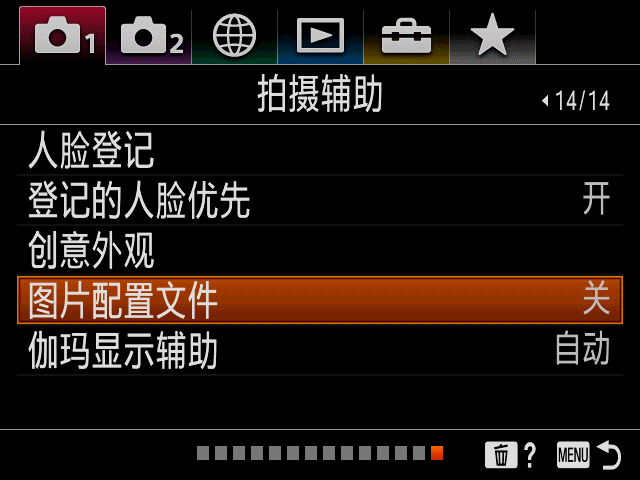

进入「创意外观」，翻到列表末尾能看到新增的 FL4 / FL5 / FL6：

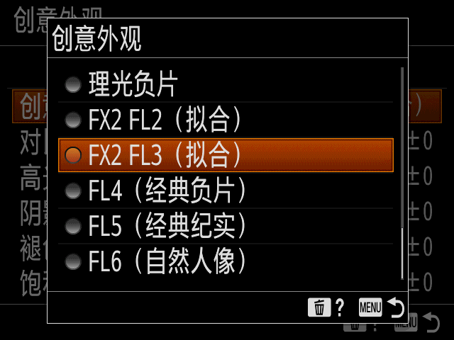

第 3 页是 R12 新加的三项——颗粒、光晕、暗角：

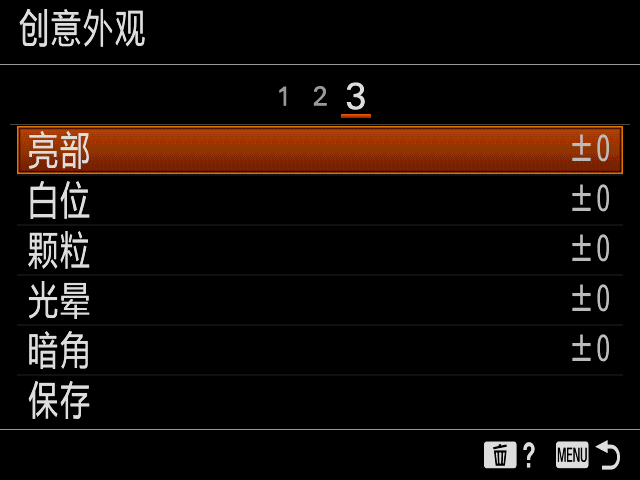

「照片效果」应该回到拍摄 1 第 12 页，「演示模式」回到设置第 3 页——这两项原本被 PP 和伽玛辅助顶掉了，现在各自归位。

### 第 4 步：4:3 保存参数

四项比例菜单在分区里，但只有菜单还不够。选 4:3 要真的能保存，还得把 51 项出图尺寸、像素数、JPEG 容量参数写进 `/setting/Backup.bin`（`nflasha2`）——那是按机身存的，不在分区里。

**这一步是参数写入，不替换分区**，写前会记录当前值，也可以单独恢复。

### 改回去

**「回退到初始备份」** 会把第一次部署前保存的分区写回相机。备份缺失或损坏时它会拒绝执行。

如果还写过 4:3 参数，需要的话用参数那一步留下的记录单独还原——它是独立的一份。

### 23 款外观的色卡

用 R12 的真实色表在机外做色彩模拟：同一组 24 个标准色块，分别过原厂基线和 23 款外观。
每块都是逐像素按上游 `classic_look_preview.py::sample` 的重建算法算出来的——Rec.709 式的
RGB/YCC 解释、5×9×9 网格三线性插值、色域裁切、8 位输出——**不是给整张卡套一个平均滤镜**，
也没有把 Lab 平均值硬套到 HSV 上。原厂那一栏同样过这套模型和真实的原厂色表，不是拿未处理的输入充数。

**这是色表预览，不是实拍 JPEG。** 实际成像还受白平衡、曝光、创意风格和色彩管理影响；
功能在实机上通过，也不等于这个 RGB 模拟已经做过色度标定。

完整 24 方案见开头那张总览，下面是分页的六方案版：

| | |
|---|---|
| 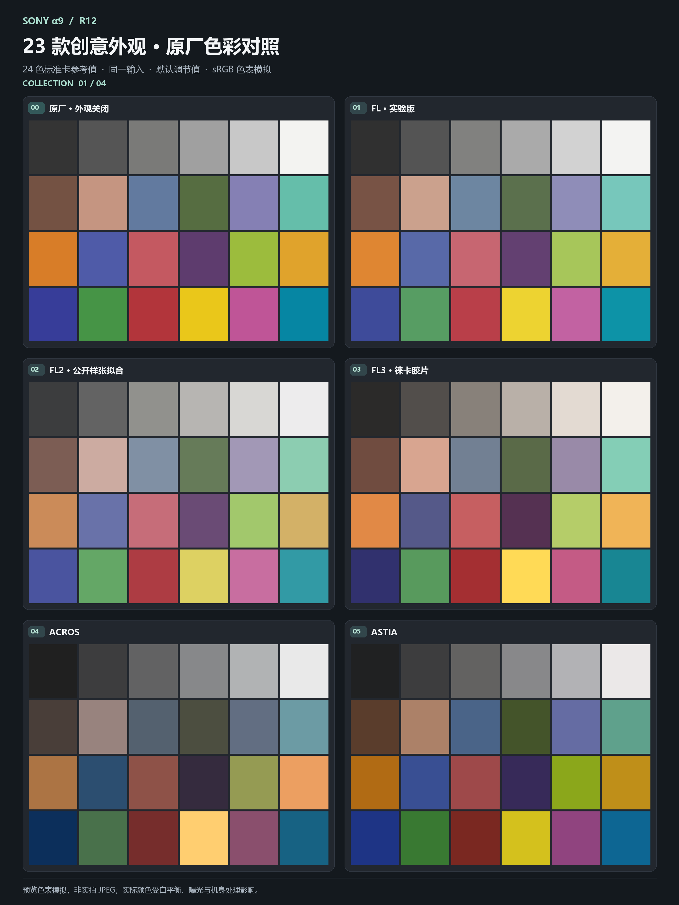 | 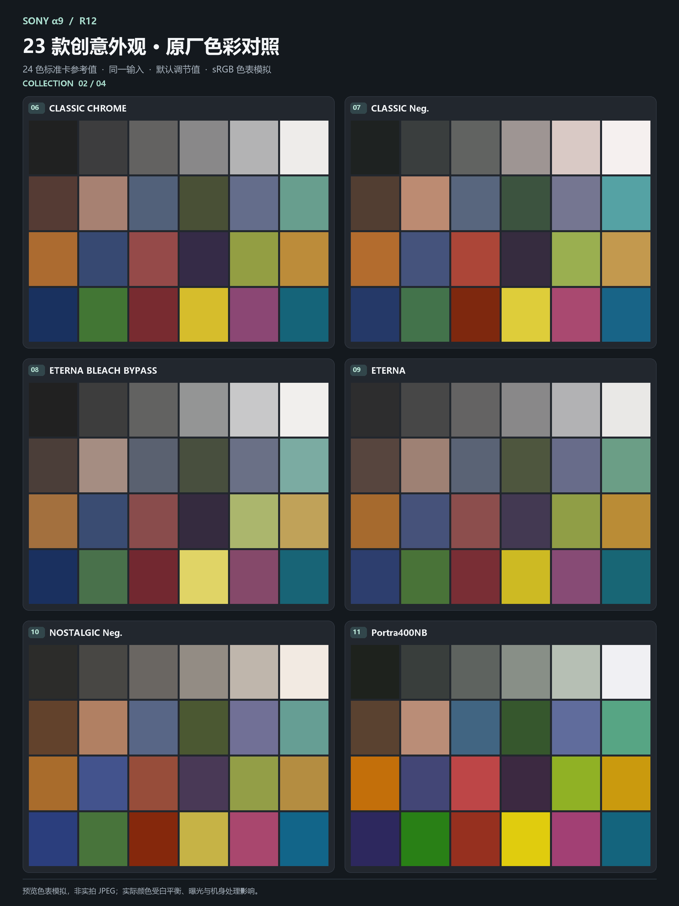 |
| 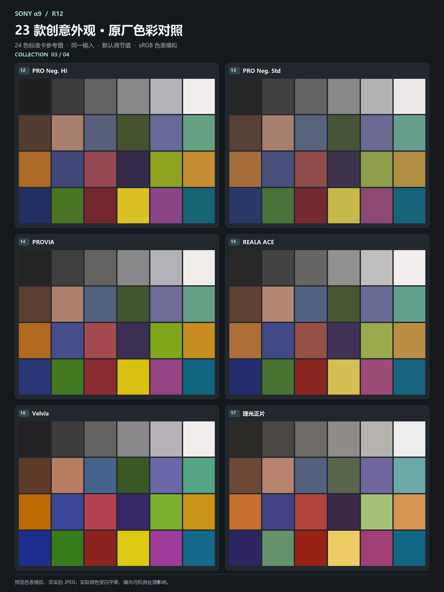 | 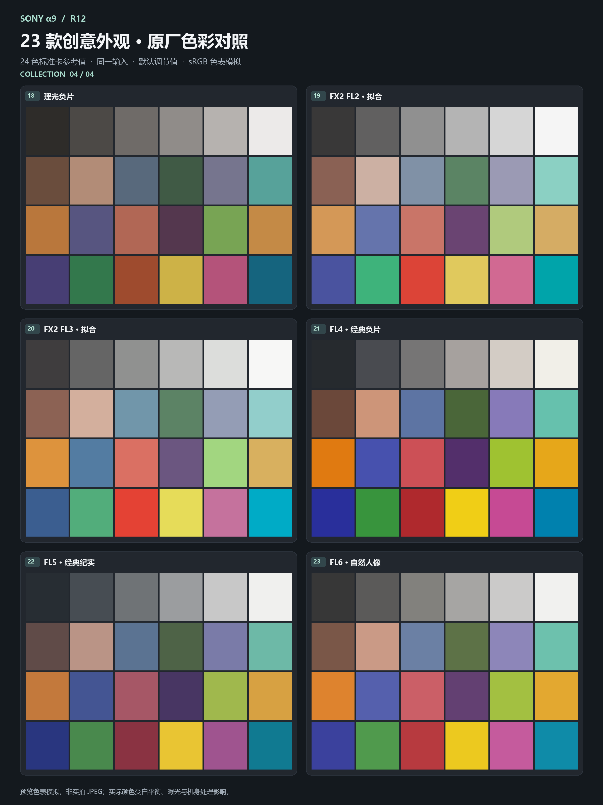 |

### 已知限制

- 23 款外观和菜单布局已实机验收；**颜色不等同于索尼、富士或理光的原厂效果**，新增 17 款是实验拟合。
- **4:3 JPEG 不行**——尺寸子菜单没有可选项，可保存张数显示 0；4:3 RAW 在补齐参数后可以保存。
- R12 的新增菜单针对 `0x4B` 布局；`0x4C` 沿用既有组织。
- 写入后第一次冷启动整分区回读与镜像的严格一致性：相机运行一次就会改写 ext2 的挂载计数和时间戳，所以整分区哈希不会与镜像完全相同。逐文件内容一致。

## 解锁 5 GHz WiFi  ⚠ 会写入相机配置

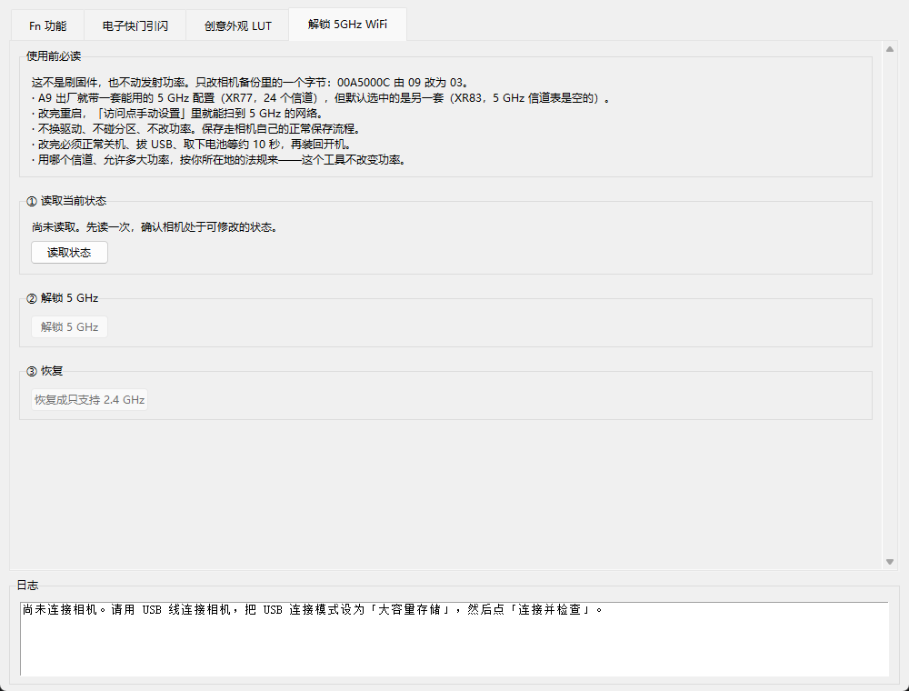

第四个选项卡让 A9 连得上 **5 GHz** 的路由器。改的是相机备份里的一个字节，不是固件。

**为什么改一个字节就够了**：A9 出厂就带两套无线电法规配置。默认选中的那套（XR83）的 5 GHz 信道表是**空的**，所以相机从来不把 5 GHz 频道报给普通路由器；另一套（XR77）已经装在相机里，有 24 个可用信道（36–64、100–140 步长 4、149/153/157/161/165）。把选择开关从 `09` 改成 `03`，相机就用它自己的第二套配置。

**不下载、不替换任何东西**：没有分区镜像、没有驱动、没有菜单库。改动通过索尼自己的 Backup 服务写入，再用相机正常的保存流程持久化。

### 怎么做

1. 相机开机，USB 设为「大容量存储」，只连这一台。**先建一个只开 5 GHz 的测试 SSID**（和 2.4 GHz 不同名），固定一个你所在地区允许的信道；20 MHz、WPA2-PSK/AES 最省事。
2. 打开 **「解锁 5GHz WiFi」** 选项卡 → **「① 读取状态」**。会读六项配置并保存一份完整备份。看到 `00A5000C = 09` 才能往下走。
3. 点 **「② 解锁 5 GHz」**，确认。
4. 正常关机、拔 USB、**取下电池等约 10 秒**，再装回开机。
5. 相机 →「网络 → Wi-Fi 设置 → 访问点手动设置」，扫描。应该能看到那个 5 GHz 的 SSID。

**只看到 SSID 不算成功。** 注册它，用原来在 2.4 GHz 上能用的 FTP 入口触发一次真实连接，再到路由器里确认相机确实关联在 5 GHz、哪个信道、拿到什么 IP，传一个小文件。最后再完整断电一次，不先打开设置页，直接用 FTP 重连。

### 改回去

**「③ 恢复成只支持 2.4 GHz」** 把 `00A5000C` 写回 `09`，同样走正常保存。其他设置——PP、S-Log、创意外观——都不受影响：它只动这一个字节。

### 已知限制

- **功率没变。** 这个改动只选配置，不动发射功率，也不做任何校准。用哪个信道、允许多大功率，按你所在地的法规来。
- 只验证过一个机身的 5 GHz 关联、信道 161 的 FTP 传输、完整断电后重连，以及 2.4 GHz 回归。信道 44 的关联、Direct / TV / 多机模式、长期压力测试都**没有测过**。
- 正常保存可能顺带更新备份文件自己的计数和校验和，所以别指望「整个备份文件只变一个字节」。
- 这项修改要求 `00A5000B=09`、`013E0061=0000`、`01071563=00`、`00A50009=00`、`00A5000A=00` 保持原厂值。任何一项被改过，工具会拒绝执行并列出是哪一项。

## 强制回退  ⚠ 用官方更新包整机恢复

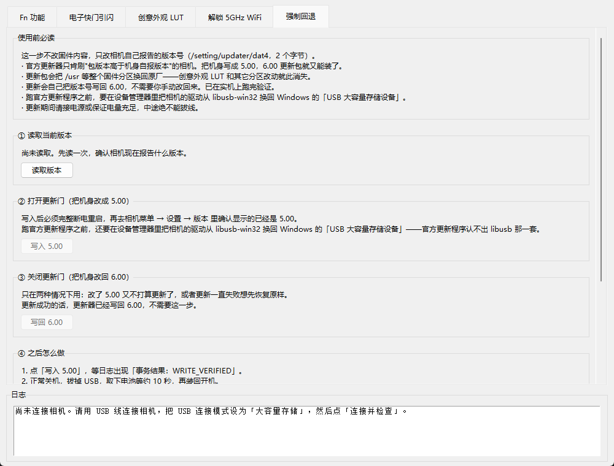

第五个选项卡用来把相机**整体**刷回原厂——不是把某一个分区写回备份，而是让 Sony 自己的更新包重写固件。

**为什么需要它**：创意外观 LUT 是整分区替换，回退时写回的是「你当初读出来的那一份」。如果那份备份本身就不是原厂（比如中途换过版本），或者你想要的是一次干净的、和出厂一致的固件，那唯一靠得住的办法就是让官方更新包重刷一遍。

**它改的是什么**：`/setting/updater/dat4`，2 个字节，小端 BCD 的版本串。这不是「副本」——它就是相机在「设置 → 版本」里显示的那个值的来源。实机验证过：把它写成 5.00 后，所有要求 6.00 的服务模式连接都被拒，说明读的就是这里。

官方更新器只在「包版本高于机身自报版本」时才肯刷，所以把机身写成 5.00，6.00 的包就又能装了。更新本身会把 `nflasha15`（/usr）、`nflasha3`、`nflasha5`、`nflasha7` 全部换回原厂。

### 怎么做

1. 打开 **「强制回退」** 选项卡 → **「① 读取版本」**。看到 `6.00`（`dat4 = 00 06`）才能往下走。
2. 点 **「② 写入 5.00」**，确认。
3. 正常关机、拔 USB、**取下电池等约 10 秒**，再装回开机。
4. **相机 MENU → 设置 → 版本，确认显示的是 5.00。** 如果这里还是 6.00，说明没写进去——回来点「读取版本」看 `dat4` 的实际值，**不要直接去更新**。
5. **把相机的驱动换回 Windows 自带的「USB 大容量存储设备」。** 官方更新程序认不出 libusb。设备管理器 → 展开 **libusb-win32 devices** → 右键 `ILCE-9` → **更新驱动程序** → **浏览我的电脑以查找驱动程序** → **让我从计算机上的可用驱动程序列表中选取** → 勾选 **显示兼容硬件** → 在列表里选中 **USB 大容量存储设备** → 下一步，等它装完。资源管理器里重新出现存储卡就说明换回来了。这和[把相机还给 Windows](#把相机还给-windows) 是同一套操作。
6. USB 连电脑（「大容量存储」），运行 Sony 官方 6.00 更新程序，按提示走完。
7. 更新结束后，相机自报版本回到 6.00（更新器自己写回），创意外观 LUT 和其它分区改动全部消失。

**更新期间请接电源或保证电量充足，中途绝不能拔线。**

### 改回去

如果写了 5.00 又改主意、或者更新反复失败，**「③ 写回 6.00」** 可以把版本号恢复原样。更新成功的话不需要这一步。

### 已知限制

- **设置大概率也会被重置。** 官方包里带着一份工厂 `Backup.bin`（1,090,266 字节，`0110_backup/…/CX79900_UC2.bin`），更新脚本 `endupdate.sh` 在收尾时会把它拷到 `/setting/Backup.bin`。所以 Fn 槽位、5 GHz 那个字节、4:3 参数很可能也回到默认。这一点**还没有在机身上逐项核对过**；如果更新后发现某项没变，用「Fn 功能」和「解锁 5GHz WiFi」各自的恢复按钮处理。
- **已经验证的只有一条完整路径**：2026-11-17 在项目自己的机身上，写 5.00 → 官方 6.00 更新包跑完 → 版本自动回到 6.00。更新中途失败、断电、半途拔线这些情况都没有试过。
- 只支持 ILCE-9。`dat4` 的编码在 A7R IV A 上静态看是同一套，但**没有任何实机验证**，本工具也不支持该机型。

## 出问题了怎么办

| 日志里看到 | 意思 | 怎么办 |
|---|---|---|
| `Service device not found` | 相机在服务模式，Windows 没有对应驱动 | 第 5 步 |
| 没有找到相机 | 没有匹配到相机 | 检查大容量存储模式、第 3 步的驱动、线缆 |
| 找到多台相机 | 插了不止一台 | 拔掉其他的 |
| `Camera busy during identity request` | 相机一直回「忙」 | 重启相机、关掉 Imaging Edge 之类占用相机的软件、重连 |
| 只支持 ILCE-9 固件 6.00 | 机型或版本不符 | 无解，程序按设计拒绝 |
| `Pipe error`（读机身参数时） | USB 传输中途断了，相机可能已经掉线 | 关机再开机、重新插线。**每次都断在同一处就别再重试**，把日志贴到 Issues |
| `sessions/…/journal.json` 里出现 `FAILED_REVIEW_REQUIRED` | 写入中途失败 | **保留 `sessions` 文件夹**，相机可能有部分改动。先在程序里恢复，再重试 |

每次写入都会在 exe 旁边的 `sessions/<时间戳>/` 留下事务记录。求助时请提供该文件的 `state` 和 `error` 字段，加上窗口底部的日志——**不要**提供整份 `Backup-original.bin`，里面有相机配置数据。

---

## 安全性

每次写入之前，程序都会在 exe 旁边存一份完整备份和事务记录，然后才碰相机；每次写入都可以在程序里撤销。

这不是索尼的工具。修改相机参数可能导致保修失效。请在自己的相机上、自担风险地使用。

---

## 自己构建

只对构建者需要，最终用户什么都不用装。

```powershell
pip install pyinstaller
powershell -File build/build_exe.ps1
```

产物：`dist/ILCE-9_Slog_Project.exe`（约 15 MB，单文件，未签名）。

不接相机也能验证打包产物：

```powershell
$env:A9TOOL_CONSOLE=1
python -m PyInstaller build/a9tool.spec --clean --noconfirm
$env:A9TOOL_SELFCHECK=1; .\dist\ILCE-9_Slog_Project.exe
```

窗口版没有控制台，所以要用 `A9TOOL_CONSOLE=1` 构建才能看到输出。它会检查 JSON 表、`sessions` 路径、包内 libusb 后端，以及主窗口能否构造出全部 77 行。

## 发布 Release

**exe 不在 git 里。** `.gitignore` 把它排除了，所以直接拿仓库做出来的 Release 里没有可下载的文件。

推一个 tag：

```bash
git tag v1.0.0
git push origin v1.0.0
```

`.github/workflows/release.yml` 会跑测试、构建、自检打包产物，然后把 `ILCE-9_Slog_Project.exe` 和 `SHA256SUMS.txt` 挂到对应的 Release 上。同一个 tag 重跑会覆盖附件。

如果你想发布本地构建出来的那个：GitHub → **Releases** → **Draft a new release** → 上传 `dist/ILCE-9_Slog_Project.exe`。

## 测试

```powershell
python -m unittest discover -s tests -t .
```

全部离线：用 `FakeCamera` 代替真机，不需要相机也不需要 USB 后端。共 236 项，含 Tk 控件状态检查，以及在禁用 site-packages 的子进程里验证 vendored 依赖可导入。

## 原理

Fn 槽位里的保存字节由 `viewUnified4.so` 的跳转表解析成内部节点 id，再查 Fn 运行根数组。这条路径**不经过主菜单树**，所以 Fn 能出现入口，而设置菜单里依然没有 Picture Profile 节点。解析器在查表前会拒绝任何大于 `0x6E` 的字节。

PP 功能放行属性（`0x00880000`，五个偏移置 `0x02`）必须先打开，否则依赖 PP 的条目解析不出东西。

## 致谢

5 GHz 解锁的思路与交叉验证来自 **[dino2048/ZV-E10-5GHz-WiFi-Unlock](https://github.com/dino2048/ZV-E10-5GHz-WiFi-Unlock)**。那个项目改的是 ZV-E10；A9 上没有照搬它的菜单库偏移或属性值——两台机器的配置编号、菜单库大小和可选配置都不一样。A9 用的是本机自己的一套选择机制（`00A5000C` → XR77）。

**17 款新增创意外观的配色来源于 [Erlla/sony-a7m4-custom-firmware](https://github.com/Erlla/sony-a7m4-custom-firmware) 的工作。** 该项目的 LUT 与外观定义是本项目拟合的依据；A9 上的实现方式是重新适配的双源属性方案，不是把对方文件直接搬进来。

菜单移植的思路来自 **[robinshie/Sony_A7M3](https://github.com/robinshie/Sony_A7M3)**（MIT），固定提交 `e6bbfafb55570a5de34e75c195e7e1c780d03340`。

它的关键做法才让这次移植成立：**把修改挂到真正的菜单创建调用上**，而不是 `DT_INIT`。此前一版在初始化时打补丁，写入和回读都正确，重启后菜单却毫无变化。其余部分——函数地址、属性记录长度、新条目的布局、扇区级的存储方案——都按本机固件重新定位和验证，不是照搬：A7 III 参考版本在这几点上与 A9 全部不同。

电子快门引闪的两处门控，以及 PP/Fn 槽位那条路径，来自本仓库 `analysis/` 下的研究工作，相关报告在交付说明里引用。

## 许可

MIT，见 [LICENSE](LICENSE)。第三方组件和固件派生表的来源写在 [NOTICE](NOTICE) 里。

带截图的版本在 `docs/`（`docs/index.html`、`docs/zh-CN/index.html`），直接用浏览器打开文件即可；图片目前是占位，需要有人在真机上拍。
